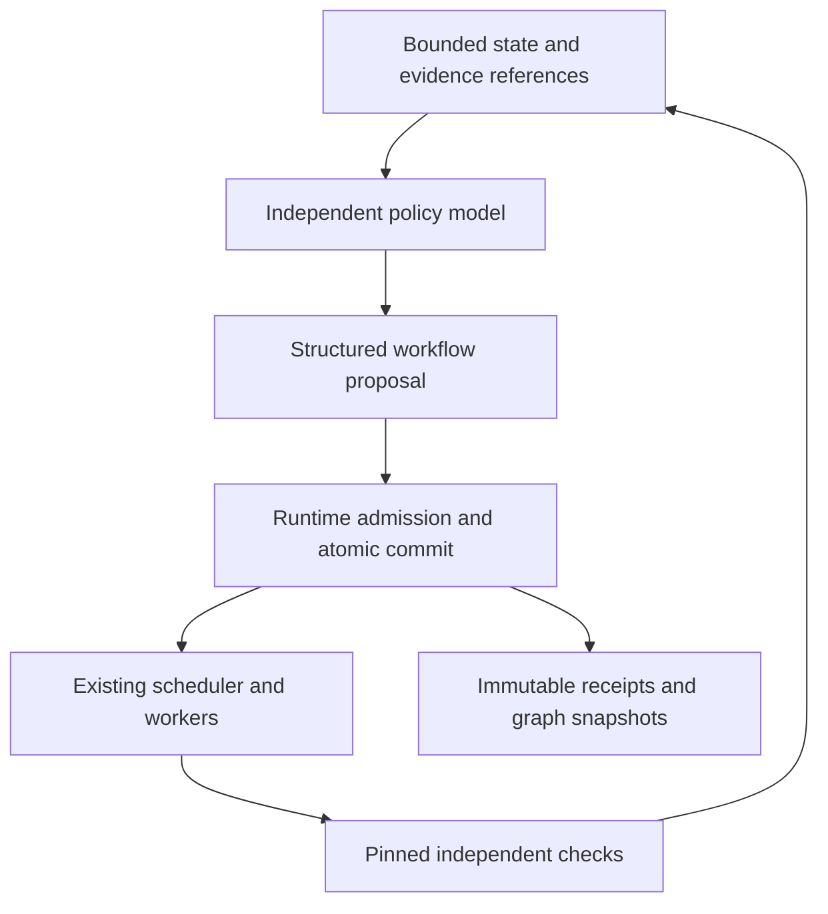

# Bounded workflow policy reviews

An executing run can consult a separate external-model role about its workflow.
That role reads a bounded state page and returns one structured proposal. The
host atomically admits or rejects it; the existing scheduler and independent
verifier retain execution and acceptance authority. This path is opt-in and
provider-neutral, with chat-completions and Anthropic wire adapters.

## What was already present

The claim that models never participated in Future-Code's control decisions was
incorrect. Before this change, workers could request `spawn_tasks`; `dynamicDag.ts`
already enforced scoped child DAGs, ordered siblings, depth/count ceilings and
parent deferral. `swarm/recovery.ts` already provided an external-model recovery
planner, admitted by `swarm/supervisor.ts`. Kernel proposal and evidence ledgers
were also present. These mechanisms should be reused.

The addition is an independent policy review **during the existing run**, with
a compact observation API and a transactional combination of permitted changes.
It does not require replacing the scheduler or giving the model database access.
Comparisons with other agent frameworks require a pinned version and an actual
capability review; broad claims that those frameworks cannot change workflows
are not used as evidence for this implementation.



## Supported operations

| Operation | Effect | Enforced boundary |
|---|---|---|
| `expand_task` | Add a namespaced child DAG to an untouched parent; sibling `dependsOn` edges select parallel or ordered work | Parent must be `READY` with fence 0; inherited dependencies, scopes, roster, protected paths, depth/count and context checks are reused |
| `set_task_timeout` | Set the deadline duration for a later attempt of a `READY` task | Operator policy and frozen contract ceilings; active leases, attempt counts, request timeouts and no-progress rules remain unchanged |
| `set_parallelism` | Lower or restore the current run's claim capacity | Range 1 through the admitted recipe's parallelism; existing work drains without preemption, scope and in-flight context reservations still apply |
| Empty `operations` | Keep the workflow | No graph/policy version change and no worker lease consumed |

Child inputs are explicit JSON, using the same grammar as worker `spawn_tasks`.
Each child retains the parent's verified direct dependencies and their views.
Policy-added children pass the normal independent checks. The parent then sees
their verified artifact/evidence references and starts with their accepted
patches applied by the existing workspace dependency closure. Its original goal,
acceptance conditions and task specification remain unchanged.

This release does not remove required nodes, rewrite existing task contracts,
arbitrarily rewire started tasks, reset retry budgets, cancel remote jobs, replace
verifiers, or let a model mark results PASS. Heterogeneous scientific work still
requires operator-pinned checks suitable for that domain. Agreement between two
models is not a mathematical proof or an acceptance rule.

## Configuration

In an operator-owned copy of `examples/swarm/spec.json`, add this `supervision`
object. Here `coder` supplies the configured external API profile for the policy
role too; the role has a separate request context and receives only the
`propose_workflow` tool. Set `agent` to another existing pinned profile to use a
different model or endpoint. Its worker tools are not exposed in policy requests.

```json
{
  "reportEveryMs": 30000,
  "checkpointEveryMs": 60000,
  "dynamicDAG": {
    "maxChildrenPerTask": 4,
    "maxDepth": 3,
    "maxSpawnedTasks": 32
  },
  "workflowPolicy": {
    "agent": "coder",
    "mode": "observe",
    "minIntervalMs": 30000,
    "maxReviews": 6,
    "maxOperations": 4,
    "maxSnapshotTasks": 24,
    "maxSnapshotBytes": 16384,
    "maxTaskTimeoutMs": 600000,
    "allowedOperations": ["expand_task", "set_task_timeout", "set_parallelism"]
  }
}
```

`observe` saves advice and its exact input without applying mutations or issuing
an admission receipt. `apply` enables the allowlisted operations. Configuration
is pinned at initialization: use a fresh state root for a changed contract.
`maxTaskTimeoutMs` must fit `limits.timeoutMs`; parallelism cannot exceed the
run's recipe. The full encoded provider envelope, including system instructions
and tool schema, must fit the contract context limit as well as the shared
request-byte budget. Snapshot bytes are only part of that envelope.

Leaving `workflowPolicy` unset makes no additional policy-model requests.
Reviews occur before scheduler refills, initially and after host-observed state
transitions, subject to the minimum interval and cumulative per-run review cap.
They do not poll on model chatter or re-review the policy's own unchanged result.
There is no policy call after all executable work has finished. Active workers
continue while a policy request is pending; that refill waits at most the
configured model-request timeout, including quota waiting and body streaming.
API errors, malformed replies and deadline failures leave worker scheduling
enabled. Provider circuit breakers and shared request budgets still apply.

## Observation, admission and recovery

Read state without enabling a policy model:

```sh
node --experimental-strip-types src/harness/foundry/swarm/cli.ts workflow \
  --root STATE_ROOT --run RUN_ID --limit 24
```

Use the returned `nextAfter` as `--task-after` for the next lexicographic page.
The page includes counts, host versions, resource ceilings, unfinished tasks,
failure previews and artifact/evidence hashes. Large fields are explicitly
marked incomplete; oversized nodes retain a visible identity instead of
disappearing from pagination. It excludes task input payloads, raw evidence and
worker transcripts. The policy request also includes run request/byte ceilings,
shared model concurrency and current metered usage, with unknown cost preserved.
The policy model receives the configured first page;
additional pages are currently available to the host/operator, not through an
interactive policy-model retrieval loop.

Each proposal carries graph, policy and state versions. The model's claimed
versions must match the **host-saved observation** and the current run inside
the mutation transaction. This also fences a response that guesses newer state.
The host's durable review reservation fences competing controllers. Full batches
roll back on any failed operation, including child rows, derived scheduler
indexes, policy overlays and events. A rejection remains in the kernel ledger.

`tasks` and `spawn_edges` remain the execution graph. Indexed timeout and
parallelism overlays hold only admitted scheduling parameters; derived readiness
indexes remain rebuildable. Structural/policy commits write content-addressed
graph snapshots and append-only receipts. A host-generated request key binds
replay to the original payload; replay returns the saved receipt without adding
children or spending another request. The receipt's post-commit state hash also
keeps replay from hiding later worker changes. Expired reviews replay an already recorded
API response. An interrupted request without a recorded response becomes
`UNKNOWN` and is not blindly resent for the same state. It remains charged in
request accounting; changed state can trigger a later bounded review.

## Validation and evaluation

```sh
node --experimental-strip-types --test \
  tests/foundry/workflow-policy.test.ts tests/foundry/dynamic-dag.test.ts
```

These deterministic tests exercise both wire protocols, real task claims and
deadlines, ordered child execution, pinned checks and final Git integration,
transaction rollback, stale/forbidden proposals, concurrent controllers, timeout
fallback and crash replay. Provider replies are scripted; this validates the
runtime and does not measure a live model's scheduling intelligence.

Run results and `status --run` include `workflowPolicy`: review statuses,
admission/rejection counts, requests, request bytes and provider-reported tokens.
Policy requests also count toward the existing run/objective request quotas and
`providerUsage`; compare total usage, not worker attempts alone. Unknown tokens
and unmetered dollar cost remain `null`. `workflow.proposal.receipt`,
`workflow.changed` and `workflow.policy.*` events link to the complete saved
inputs, proposals, receipts and accepted graph snapshots.

For efficacy, follow [paired real-project evaluation](REAL_PROJECT_EVALUATION.md):
same root tasks, base commit, model, tool/check roster and total request ceilings,
with policy disabled versus enabled. Report independent completion/integration
success, total wall time, requests/tokens/cost, failed attempts, policy overhead,
and rejected/stale proposal rates. Stratify short tasks and long heterogeneous
tasks. Count every control-plane request and unknown interrupted request. The
feature provides a measurable policy hook; a large productivity gain is not
claimed without these external-API trials.
