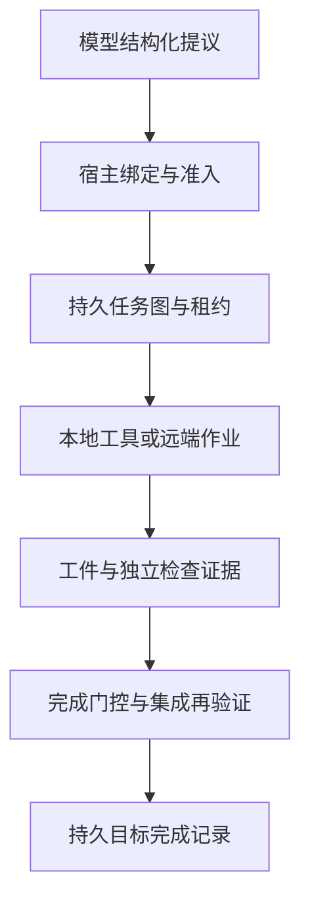
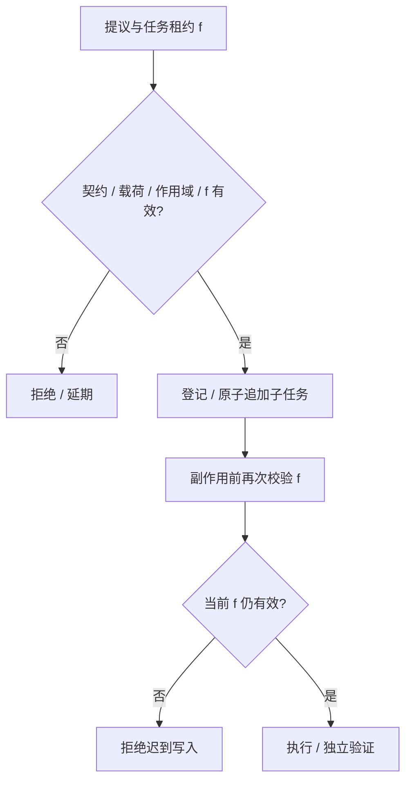

发明专利技术交底书
**一种研发智能体的外部作业协调及完成控制方法**
修订日期：2026-10-13
编制单位：中国移动通信有限公司研究院（中国移动研究院）
发明人：许达、王飞
代码复核基线：`249b8ccafee935a66accab3ae37c65742b11ecd3`

# 发明名称
一种研发智能体的外部作业协调及完成控制方法。

英文名称：External Job Reconciliation and Completion Control for Research and Development Agents。

# 申请人信息
| 字段 | 内容 |
|---|---|
| 申请人名称 | 中国移动通信有限公司研究院 |
| 申请人类型 | 按院内申报登记信息填写 |
| 国籍/注册地 | 按院内申报登记信息填写 |
| 统一社会信用代码 | 按院内申报登记信息填写 |
| 通讯地址 | 按院内申报信息填写 |
| 邮政编码 | 按院内申报信息填写 |
| 联系电话 | 院内填写 |
| 电子邮箱 | 院内填写 |

正式申请主体及共同申请安排由院知识产权管理部门按职务发明流程核定。

# 发明人信息
## 第一发明人
| 字段 | 内容 |
|---|---|
| 姓名 | 许达 |
| 国籍 | 由本人通过院内申报流程填写 |
| 工作单位 | 中国移动通信有限公司研究院 |
| 职务/职称 | 由本人通过院内申报流程填写 |
| 通讯地址 | 院内填写 |
| 邮政编码 | 院内填写 |
| 联系电话 | 院内填写 |
| 电子邮箱 | 院内填写 |

其他发明人：王飞。工作单位：中国移动通信有限公司研究院；其他身份及联系信息由本人通过院内申报流程填写。

# 技术领域
本发明涉及人工智能智能体运行时、软件工程自动化、分布式计算、计算机任务调度、故障恢复及验证证据管理领域，尤其涉及在模型调用、任务执行与远端计算之间发生超时或进程故障时，对操作授权、远端作业身份及目标完成状态进行一致性控制的方法。所述研发任务包括软件开发、模型训练与仿真，不限定于某一科研项目。

# 背景技术
## 现有技术的局限性
已有大模型智能体编排、DAG 任务并发、持久工作流、事件重放、租约 fencing、熔断与幂等外部调用。相关专利 CN120560815A、US20250356313A1、US20260127463A1 已分别覆盖任务拆分、代理管理及动态工作流；Temporal 等产品也公开了持久执行与副作用恢复技术。因此上述单一构件不宜直接作为新颖性依据。

在长期研发流程中，故障可能跨越多层边界：模型提出的操作在执行前已失去权限；先前有效的 worker 在租约转移后迟到提交；外部训练请求已到达远端但回执丢失；多个子任务分别通过但合并树无法验证；冲突证据或未知外部作业被错误归类为完成。2026-10-08 Temporal 公开的 Pi 代理持久化方案已经描述了工具执行前记录 pending 声明、结果未知时不自动重放，故仅把“未知结果不重试”写成独立创新也存在较高风险。

## 长期任务的状态一致性与验收问题
目标由运行标识、验收契约及执行配置关联的持久记录表示。验收契约规定检查项和权限边界；冻结表示执行中不能由模型改写，不表示文件本身不可损坏。任务租约包含当前执行代际和截止时间。宿主需要在提议准入及实际操作边界核验这些绑定；远端调用超时后仍保留原作业身份；最终完成需要工件及其验收证据。

本地租约校验只能拒绝失效执行者的宿主写入和结果接纳，不能撤回已发往远端的请求，也不能证明远端物理副作用没有发生。因此还需要远端幂等确保协议和目标级未决作业检查，分别处理远端重复执行与本地误判完成。

## 现有智能体运行时及其扩展挑战
工作流重放、幂等键与独立测试本身是成熟方法；本交底书拟保护其在“模型只提交提议—宿主准入并复核权限—持久外部作业协调—冻结目标验收”中的具体数据约束和状态门控组合。可专利性仍取决于同一技术效果是否可由现有技术显而易见地组合得到，参见配套检索报告。

# 发明内容
## 发明目的
本发明通过相互关联的持久记录，处理三个计算机执行问题：操作提议在执行前失去权限、远端作业已启动但回执丢失、局部检查通过被错误提升为整体完成。宿主控制提议准入，远端适配器协调作业身份，完成模块检查未决作业及组合工件的证据。该流程用于减少重复计算与错误完成状态；实际保障范围取决于存储、适配器和检查器的可信性。

## 技术方案
系统由模型适配器、宿主提议准入器、持久任务图及租约调度器、远程作业协调器、可信验证器、证据存储和最终集成门控构成。宿主持有目标标识、验收契约摘要 contract_hash、执行配置摘要 recipe_hash 与任务租约，LLM 只能提出结构化建议，无权自行发布 PASS、改变检查器或对数据库执行越权写入。

### 技术特征 A：结构化提议与副作用前双重权限校验
模型输出操作类型 kind 与 payload，宿主补入 run_id、task_id、fence、contract_hash、recipe_hash，以规范化载荷计算 payload_hash 与 proposal_id。首次准入时核查登记身份、载荷、范围、租约和契约，记录 ADMIT/REJECT/DEFER；执行有副作用的工具前再次从追加式记录载入并复核当前任务的 RUNNING、fence 和 deadline。提议准入与实际操作复核使用同一持久身份；已准入的回执不能恢复过期租约。摘要用于内容完整性核验，不是数字签名，也不能抵御具有数据库写权限的恶意宿主。

### 技术特征 B：冻结父规格、代际租约与原子式动态裂变
父任务已准入的目标、验收和 read/write scope 不作原位变更。动态裂变在单个持久事务内核验父任务租约、request_key/request_hash、子任务 ID、祖先依赖、写范围、深度及总数量，追加 spawn_request、spawn_edge 和子任务；重放相同请求返回既有子任务，相同 key 携带不同 hash 被拒绝。任务结果只有在当前 fence 有效且独立验证通过后方可接纳。

### 技术特征 C：远程作业的意图持久化与幂等确保协议
对远程训练、仿真、编译等外部作业，宿主依据 (run_id,task_id,tool_call_id,job_template) 派生稳定 key，并依据已固定的 adapter、template、input 和 base_commit 计算 input_binding。首次网络调用前在事务中写入 research_jobs(key,input_binding,status=UNKNOWN) 与 job.intent；对现有记录核验 input_binding 不变。若已有 job_id 则向适配器发送 inspect(key,job_id)；否则调用由适配器承诺支持的 idempotent ensure(key,input_binding)，由远端依据稳定 key **返回原作业或原子创建**。失联时仍保持 UNKNOWN 并按期限再次协调。对同一持久工具调用，恢复须沿用原 key；重新生成 call_id 会改变 key，故旧作业未协调前不能另建替代运行。若适配器不具备可信的幂等确保/查询语义，系统必须停止自动提交并请求人工协调。该机制仅在远端履行其接口契约、台账持久化时减少重复作业，不承诺无条件 exactly-once。

### 技术特征 D：共享模型 API 故障代际与不占用工作槽的等待
同一 quota_pool 对应一条持久 agent_provider_health 记录，保存 failures、epoch、retry_at。网络或可重试 HTTP 错误将资源池置于冷却状态；等待者释放执行槽并持久化唤醒时间。到期由事务性准入限制探测，只有所属 epoch 匹配的成功回应才可消除故障；旧 epoch 迟到回应不得清除新故障。认证、配置、响应格式等错误不自动视为临时故障。

### 技术特征 E：多条件证据门控与合并树再验证
当前运行的全部登记任务须为 PASS，且具有工件和独立机器检查证据；完成门控还要检查当前运行中未关闭的证据冲突及失效主张，并检查同一目标当前及历史修订运行的外部作业。作业仅有自报终态仍不足以验收候选工件。

在集成检查前执行一次完成门控，组合各任务工件后按冻结配置执行检查，在集成检查后再执行门控，避免长时间检查期间出现的新冲突被先前的通过快照掩盖。已缓存的集成结果也须重新核验工件及证据。最终完成记录保存目标、当前运行、修订谱系、外部作业清单摘要及集成回执；重启后读取同一已接受记录。

### 技术特征 F：可选证据布局与恢复建议隔离
在单独的可选 HACT 证据导出路径中，stable check_id、canonical evidence 与 checker identity 属语义状态；排列及层次树仅影响展示/传输。布局代际改变时，旧票据在受支持的票据核验路径上失效；completion hyperedge 可用于离线比较候选布局。该扩展不修改 Foundry 目标完成门控，也不保证所有验证负载都受益。历史 intervention memory 只提供建议，不修改验收标准、预算或权限。F 的布局优化与本案外部作业一致性问题不同，本次不将其列入拟议权利要求；保留为需专项检索的后续主题。

# 附图说明
图1为模型提议、宿主控制及证据验证的数据流；图2为提议绑定、租约校验和动态子任务原子准入流程；图3为远端作业的 ensure/inspect 协调与目标完成门控流程。





```mermaid
flowchart TD
  I[事务中持久化 intent / stable key] --> K{本地已有 job_id?}
  K -- 是 --> Q[inspect(job_id)]
  K -- 否 --> S[idempotent ensure(key)]
  S --> U{状态 / 回执}
  Q --> U
  U -- UNKNOWN --> D[持久等待 / 继续协调]
  D --> K
  U -- 终态 --> E[记录终态回执与检查证据]
  E --> G{冲突和未解决作业为零且集成验证通过?}
  G -- 否 --> H[BLOCKED / NEEDS_ATTENTION]
  G -- 是 --> Y[COMPLETE]
```

# 具体实施方式
## 系统架构
参考实现的代码基线为 `249b8ccafee935a66accab3ae37c65742b11ecd3`。参考实现使用支持唯一键及事务的 SQLite 存储。runs 表保存契约与配置散列，tasks/attempts 保存租约和结果；kernel_proposals/kernel_admissions 保存带身份绑定的操作提议与准入记录；spawn_requests/spawn_edges 使子任务裂变可去重；research_jobs 的 key 唯一且 input_hash 不可在重放时漂移；目标记录及修订谱系把旧运行的作业纳入完成门控；agent_provider_health/admissions/waits 持久化资源池代际与唤醒时间；fabric_conflicts、claim 状态和目标完成记录参与完成门控。任务存储或协议适配器的可信性为实施前提，Git worktree 隔离代码版本，执行不受信任代码还需另行配置操作系统级隔离。

**数据记录与接口：**
逻辑字段与实际存储映射如下。示例以规范化 JSON 和 SHA-256 摘要建立内容绑定；同等实现可使用其他满足完整性要求的摘要和支持事务的持久存储。

运行记录 runs；id、contract、recipe；关联冻结契约和执行配置摘要。

操作提议 kernel_proposals；id、envelope_hash；封套含 run、task、fence、payloadHash；拒绝改写载荷及跨运行复用。

准入记录 kernel_admissions；proposal、verdict、seq；记录准入结果；复用时仍重新校验。

任务记录 tasks；run、id、status、fence、deadline、artifact、evidence；核验当前执行权和任务接受证据。

作业记录 research_jobs；key、input_hash、job_id、status、result_hash、reconciliation_hash；保留未知结果和终态回执身份。

目标修订与完成记录；objective、run、revision、attestation；跨修订核对作业并重放已接受完成记录。

远端请求包含 schema、operation、key、jobId、input、inputHash、baseCommit。operation 为 ensure 或 inspect；首次 jobId 为 null。响应包含 schema、key、非空 jobId、status，可选 progressToken 和 result；SUCCEEDED 必须含 result。宿主核验键、既有 jobId、状态枚举和大小上限。FAILED 或 CANCELLED 只表示外部作业已终结，不能替代目标的成功证据。

适配器需把 key 与 inputHash 持久绑定，使并发的相同 key 确保请求返回原作业或原子建立一个作业；相同 key 的输入漂移必须拒绝。此为部署前需核定的接口契约，本地 idempotentEnsure 配置标志本身不能证明远端已履行契约。

## 实施步骤
### 实施例 1：长周期软件研发任务的接纳与验收
S101：操作员提交目标 O、固定输入提交 X0、检查器及执行权限，宿主形成契约 C 和 recipe_hash。S102：模型提出含 kind、payload 的操作，宿主补齐运行和租约信息、规范化计算提议哈希，落地追加式记录并判定 ADMIT。S103：执行工具前读取提议和最新 tasks 行，再次核查 hash、RUNNING、fence 和 deadline。S104：父任务请求裂变时核查 request_key、祖先依赖、数量和作用域，在事务中追加子任务与边。S105：租约 A 过期后交给 B，迟到的 A 因 fence 不符而被拒绝。S106：全部登记任务具有已接受工件和证据后，先检查完成门控，在组合树运行冻结集成检查，再核对门控和同一目标历史作业，生成持久完成记录并置为 COMPLETE。

### 实施例 2：不确定远端训练结果的恢复
S201：模型在经过准入后调用配置的 run_job；本地构造 key=H(run_id,task_id,call_id,template)，binding=H(adapter,template,input,base_commit)。S202：在首次向远端发送请求前插入 status=UNKNOWN 的 research_jobs 唯一键记录与 job.intent 事件。S203：如远端已返回 job_id，则请求 inspect；否则以同一 key 调用已核定的 idempotent ensure。适配器在其受控持久状态中以 key 去重，保证重复 ensure 不创建另一份物理作业。S204：若 RPC 中途断开，保留 UNKNOWN 和重试时刻，绝不以新 key 代替旧作业；若适配器返回“无法协调”，转人工核对并阻止目标完成。S205：终态回复须具有一致的 key/job_id/status；SUCCEEDED 还需 result。将 reply 及其 reconciliation receipt 持久化，随后经独立检查器核验预设实验指标。检查通过说明满足所配置的验收要求，不构成对任意科学结论真实性的保证。

### 实施例 3：模型 API 故障与证据导出
S301：一次暂时性模型 API 错误使共享资源池 epoch 增加并设 retry_at，原执行槽释放。S302：旧请求晚到的成功回复因 epoch 不匹配，不能清除新周期冷却；新请求到期受控探测后方可恢复通常并发。S303：可选 HACT 导出模块为检查项建立稳定 ID，以 canonical evidence 计算验证结果，另以树布局组织证据包。S304：若布局更换使 generation 改变，旧导出票据被受信核验器拒绝，目标级 PASS 的判定仍由冻结检查器及完成门控决定。

**状态一致性与异常处理：** 宿主写入须满足任务为 RUNNING、当前 fence 与提议一致且 deadline 未过期。外部作业的同一 key 始终绑定相同 input_hash；UNKNOWN 表示未确认结果，不能推断作业不存在。未获得可信的终态协调回执时，作业保持未解决，阻止完成并抑制替代运行。

完成记录要求当前运行全部登记任务有已接受工件和证据，同一目标全部修订运行无未决作业，当前运行无未关闭证据冲突及失效主张，且组合树检查通过。这里的门控是指定宿主执行流程的保证，不构成对任意数据库写者的全局可串行化证明。数据库损坏、适配器失信、检查器污染、预算耗尽或用户取消均需显式处理，不能视为已完成。

# 技术效果
## 执行正确性
通过提议身份、契约摘要和 fence 的重复核验，拒绝不同运行或失效租约的宿主结果写入；以原子追加子任务确保同一请求的确定性重放；将模型自述的成功与机器验收隔离。效果取决于宿主存储原子性、可信检查器及权限检查实现。

## 高性能与经济可行性
API 冷却期间释放任务执行槽，降低忙等占用；幂等 ensure 和稳定作业身份能够在兼容远端适配器的前提下减少重复训练/仿真开销；独立任务可并行。上述收益随故障率、作业长度、任务图并行宽度和验证成本变化，本交底书不主张固定加速倍数或优于其他代理框架的通用性能结论。

**行为对比**

| 指标 | 本方案 | 对照情形 | 核验依据 |
|---|---|---|---|
| 迟到写入 | 复核当前租约与提议绑定 | 仅复用旧准入回执 | sovereignty.test.ts |
| 远端恢复 | 原键ensure或既有作业号inspect | 超时后以新身份重新提交 | resilience.test.ts |
| 目标完成 | 作业、证据及集成前后共同门控 | 仅依据局部任务PASS | resilience-e2e.test.ts |
| 效果范围 | 103项受控测试通过 | 尚无真实模型或远端性能对照 | 已注明基线及条件 |

## 系统健壮性
数据库记录 UNKNOWN、重放身份、故障 epoch 和未解决证据，遇不可判断的远端副作用时阻断目标验收而非盲目重投。自动恢复不能突破权限、目标总预算、人工停止或长期不可用的外部服务。候选负测包括：旧租约提交被拒、相同 key 不同 input_hash 被拒、重复 ensure 返回同一 job_id、未知作业不生成 COMPLETE、局部 PASS 而合并检查失败时拒绝 COMPLETE。


**故障核验：**
2026-10-13 在所列代码基线上，以 Node.js 24.19.0 运行七个现有测试文件，103 项通过、0 项失败。测试覆盖宿主与受控适配器，不等同于真实模型生产力或真实远端服务的性能测量。

已核验的故障包括已准入载荷漂移、旧租约、重复子任务、远端回执丢失、作业身份漂移、未决作业和证据冲突、集成缓存证据失效及旧服务成功迟到。对应七个现有测试文件及复现命令见专利目录审阅记录。
# 权利要求书
以下为与实施例对应的拟议保护范围，供院知识产权管理部门及专利代理人定稿。
## 独立权利要求

**权利要求1：** 一种研发智能体的外部作业协调及完成控制方法，其特征在于，由计算机宿主执行以下步骤：

（1）建立目标标识、运行标识、验收契约及执行配置的持久关联记录，所述验收契约包括工件检查项和执行权限，所述契约与配置分别由摘要绑定；

（2）接收大模型的结构化操作提议，由宿主将提议与所述运行标识、任务标识、任务租约代际、契约摘要、执行配置摘要及载荷摘要绑定并持久记录准入结果；在执行相应工具操作前，重新核验已登记提议及当前任务状态、租约代际和有效期；

（3）针对准入的远端计算作业，在首次调用远端接口前，持久写入由运行标识、任务标识和工具调用身份派生的作业键，以及与固定适配器、输入和基准工件绑定的输入摘要及未知状态；没有已知远端作业号时，以原作业键调用具备持久去重能力的确保接口，已有远端作业号时调用查询接口；

（4）核验远端响应的作业键、作业号和状态，并持久保存终态回执及其绑定摘要；无法确认终态的作业保持未解决，不因超时推定不存在，也不通过新建替代运行绕过该作业；

（5）将当前运行各任务的候选工件与独立机器检查证据关联，在集成检查前以及组合工件的集成检查后分别执行完成门控；所述门控检查当前运行全部登记任务具有已接受工件和证据、当前运行没有未关闭证据冲突及失效主张、同一目标关联运行没有未解决外部作业；

（6）仅在所述门控通过且与冻结契约及配置关联的集成检查通过后，持久发布包含目标及运行绑定、外部作业清单摘要和集成回执的完成记录。

**权利要求2：** 一种智能体执行系统，包含模型提议适配器、宿主准入模块、任务租约模块、外部作业协调模块、验证证据模块及集成验收模块，其协同执行权利要求1所述方法。

**权利要求3：** 一种电子设备，包括处理器和存储器，存储的指令由处理器执行时实现权利要求1所述方法。

**权利要求4：** 一种非暂态计算机可读存储介质，存有使计算机实现权利要求1所述方法的程序指令。

## 从属权利要求

**权利要求5：** 根据权利要求1所述方法，其中宿主使用规范化载荷计算提议身份，将提议历史和准入结果以不可变记录保存，并在既有准入被复用时重新核验提议内容与当前租约代际。

**权利要求6：** 根据权利要求1所述方法，其中对已准入父任务仅以追加关系登记动态子任务，并在同一事务中验证 request_key、request_hash、父租约、子任务深度、数量、依赖与作用域；相同请求身份但载荷不同的重放被拒绝。

**权利要求7：** 根据权利要求1所述方法，其中所述稳定作业键通过运行标识、任务标识、工具调用标识和作业模板标识的散列生成，输入绑定通过固定适配器、模板、输入和基准提交生成，远端适配器以该键对确保请求作去重处理。

**权利要求8：** 根据权利要求7所述方法，其中当远端适配器无法提供幂等确保/查询保证或任务结果身份不一致时，将作业标记为待协调状态，暂停自动重投并阻止目标完成。

**权利要求9：** 根据权利要求1所述方法，其中已缓存的集成回执不能免除工件与证据的重新核验，缺少必需检查证据、引用工件损坏或验收契约不一致时拒绝完成。

**权利要求10：** 根据权利要求9所述方法，其中相互矛盾的强证据产生冲突记录，宿主准入只读判别任务，并要求其独立机器检查证据与同一运行、被裁决主张和候选工件绑定；模型自报或未决证据不能关闭冲突。

**权利要求11：** 根据权利要求1所述方法，其中同一模型资源池存储故障 epoch 与 retry_at，在冷却期间释放工作槽，只允许当前 epoch 的受控成功探测恢复准入，迟到的旧 epoch 成功结果不清除当前故障。

**权利要求12：** 根据权利要求1所述方法，其中目标关联运行包括目标的当前运行和历史修订运行；替代运行的建立不能移除旧运行中的未解决作业，所述作业仍参与同一目标的完成门控。

**权利要求13：** 根据权利要求12所述方法，其中完成记录还包含目标修订谱系及各外部作业终态回执的清单摘要；完成后再次启动宿主时，读取并核验原完成记录的目标及运行绑定，复用该记录而不重新生成另一完成结论。

# 说明书摘要
本发明公开一种研发智能体的外部作业协调及完成控制方法、系统、电子设备和存储介质。宿主将模型操作提议与冻结验收契约、任务租约代际和载荷散列绑定，并在副作用执行前再次验证授权；针对远端训练、仿真任务，先持久化稳定作业身份和未知提交状态，再通过幂等确保或状态查询接口协调恢复；对候选工件建立独立验证证据，在未决作业、冲突或最终集成验证失败时阻断目标完成。方案用于降低长周期研发流程的迟到写入、重复作业及局部验收误判风险。
